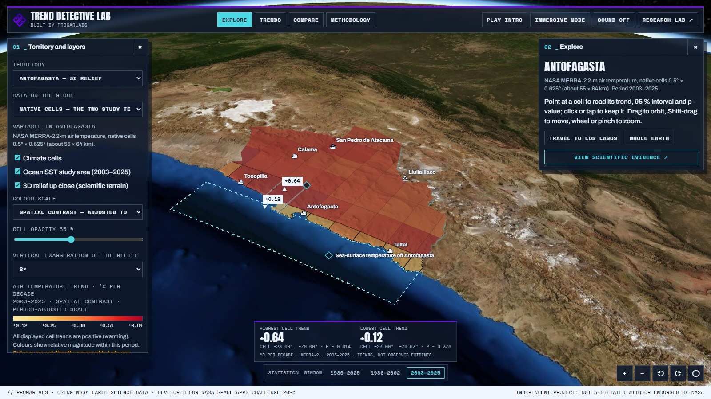
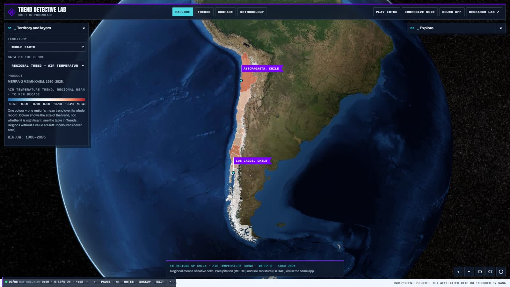

# Trend Detective Lab

**Explore Earth. Understand Change.**

A regional average can hide opposite changes inside a region, two NASA products can disagree, and a trend can flip with the period you choose. **Trend Detective Lab** puts NASA Earth data for Chile's 16 regions on a 3D globe and runs every trend through an honest statistical test — with its uncertainty, a direct test of differences between places, and a plain statement of what the evidence can and cannot show.

**[▶ Live Earth Atlas](https://giuseppeprbst.github.io/trend-detective-lab/)** · **[Official 30-second demo](https://github.com/GiuseppePrbst/trend-detective-lab/releases/tag/nasa-spaceapps-2026-demo)** · **[Research Lab](https://giuseppeprbst.github.io/trend-detective-lab/?view=lab)** · **[Presenter mode](https://giuseppeprbst.github.io/trend-detective-lab/?present=1)** · **[Scientific evidence](docs/discovery/EVIDENCE_CARDS.md)**

NASA Space Apps Challenge 2026 — *Be An Earth System Trend Detective!* · Team **ProGarLabs** (Local Event Quemchi, Chile): Giuseppe Proboste, Fabiana García · Apache-2.0



*Real screenshot of the live app: Antofagasta, 2003–2025. Each coloured footprint is one native MERRA-2 cell and its computed air-temperature trend, clipped to the region; dashed outline: the NASA MUR sea-surface temperature study area.*

## 1. The challenge

Anyone can draw a line through a climate record. The hard part is knowing whether that line means anything. Monthly climate data are not independent measurements, records are short, regional averages hide where change happens, products disagree, and "one region is significant and the other is not" is routinely misread as "the two regions are different". The challenge asks for a tool to select Earth-science variables, see how they change over time and determine what is changing, where, and whether it is significant. We built one that also shows **what the data do not allow us to conclude**.

## 2. What we built

| Layer | What you get |
| --- | --- |
| **Discovery — Earth Atlas** ([live](https://giuseppeprbst.github.io/trend-detective-lab/)) | A CesiumJS globe with Chile's 16 regions coloured by their NASA trends (air temperature, precipitation); native NASA cells clipped to two study territories (Antofagasta, Los Lagos) on 3D relief (Three.js); the highest and lowest cell trend shown automatically; statistical windows 1980–2025, 1980–2002, 2003–2025; a colour scale that is either adjusted to the window (*spatial contrast*) or fixed across windows (*fixed comparison*), always labelled; the coastal sea-surface temperature study area; four georeferenced study pins; flights between territories. |
| **Evidence — Research Lab** ([live](https://giuseppeprbst.github.io/trend-detective-lab/?view=lab)) | For any region and variable: time series, trend with 95 % confidence interval, p-value and false-discovery-rate q across 16 regions, a direct test of the difference between two regions, period sensitivity, cross-checks against ERA5 and weather stations with their dependencies stated, a multivariable lab (GLDAS soil moisture, evapotranspiration, snow), and evidence cards saying what each result supports and what it does not. |
| **Film** ([30 s demo](https://github.com/GiuseppePrbst/trend-detective-lab/releases/tag/nasa-spaceapps-2026-demo)) | A 30-second film rendered frame by frame from the app itself: descent to Antofagasta, the relief, the cells, the yearly anomalies 1980–2025 drawn year by year, and the change of conclusion between windows. |
| **Presenter mode** ([`?present=1`](https://giuseppeprbst.github.io/trend-detective-lab/?present=1)) | The jury presentation runs inside the live app: eight cues, one key per step, the figures read from the published results, the real Research Lab over the globe, timer, notes and backup captures ([guide](docs/presentation/PRESENTER_GUIDE.md)). |
| **Reproducibility** | An open Python pipeline (fetch from NASA Giovanni → aggregate → test → validate → JSON for the app), science and frontend tests in CI, browser smoke tests. **The web app computes no statistics**: it shows what the pipeline calculated. |



## 3. Explore in 60 seconds

1. **Open the planet:** https://giuseppeprbst.github.io/trend-detective-lab/ (drag to turn, wheel to zoom).
2. **Chile:** click any region, or pick one in *Territory*; *Data on the globe* switches to the regional air-temperature or precipitation layer for all 16 regions.
3. **Antofagasta:** click the *ANTOFAGASTA, CHILE* flag — or open [`?region=antofagasta`](https://giuseppeprbst.github.io/trend-detective-lab/?region=antofagasta). Point at a cell for its trend, interval and p-value.
4. **Compare periods:** switch the *Statistical window* to 2003–2025 ([direct link](https://giuseppeprbst.github.io/trend-detective-lab/?region=antofagasta&period=2003-2025)); choose *Fixed comparison* to compare windows on one colour scale.
5. **Open the evidence:** *View scientific evidence ↗* → the [coast-and-interior investigation](https://giuseppeprbst.github.io/trend-detective-lab/?view=lab&q=coast) in the Research Lab.

## 4. Scientific findings

All numbers are generated by the pipeline: [`docs/results.md`](docs/results.md), [`docs/multivariable/TERRITORIAL_RESULTS.md`](docs/multivariable/TERRITORIAL_RESULTS.md), [`docs/discovery/EVIDENCE_CARDS.md`](docs/discovery/EVIDENCE_CARDS.md).

**A. Antofagasta vs Los Lagos — confirmatory (question fixed before any data were downloaded).** In MERRA-2, 1980–2025, Antofagasta warmed +0.23 °C per decade (95 % CI +0.11 to +0.35) and Los Lagos +0.05 (−0.04 to +0.14). Tested directly on the difference series, the trends differ by **+0.18 °C per decade (95 % CI +0.05 to +0.31, p = 0.006)**. ERA5 at matching points agrees on the regional samples; the coastal Antofagasta station does not show the regional warming — which led to finding B.

**B. Antofagasta, coast vs interior — exploratory, and sensitive to the period.** Over 1980–2025 the coastal cells show −0.03 °C per decade (CI −0.19 to +0.14) and the interior +0.27 (+0.14 to +0.39): difference −0.29, p < 0.001; ERA5 shows the same contrast. The contrast comes from 1980–2002 (coastal cells cooled). **In 2003–2025 both warm (+0.43 and +0.52) and the difference is not significant**; the coastal sea-surface temperature (NASA MUR, 2003–2025) is +0.11 °C per decade, not significant. Coast and elevation are confounded at this resolution (ρ = 0.90): an ocean influence is plausible, not proven.

**C. Magallanes — the datasets disagree.** IMERG shows a significant precipitation decline (−12.2 mm/month per decade, 1998–2024, p = 0.001, q = 0.02 across 16 regions) that neither the Punta Arenas station nor ERA5 reproduces; MERRA-2 shows no warming (p = 0.97) while ERA5 and the station show significant warming. The app shows the disagreement instead of choosing a winner.

What we do **not** claim: causes, forecasts, or that "not significant" means "no change".

## 5. NASA data

| Product | Variable | Native resolution | Nature | Period | DOI | Accessed through |
| --- | --- | --- | --- | --- | --- | --- |
| MERRA-2 `M2IMNXASM` v5.12.4 (GMAO) | 2-m air temperature (`T2M`) | 0.5° × 0.625° (~50 km) | **Reanalysis** (weather model + observations) | 1980–2025 | [10.5067/5ESKGQTZG7FO](https://doi.org/10.5067/5ESKGQTZG7FO) | NASA Giovanni time-series service (GES DISC) |
| GPM IMERG Final Run `GPM_3IMERGM` V07 | Precipitation | 0.1° (~10 km) | **Satellite** estimate merged with rain gauges | 1998–2024 | [10.5067/GPM/IMERG/3B-MONTH/07](https://doi.org/10.5067/GPM/IMERG/3B-MONTH/07) | Same service |
| GLDAS-2.1 Noah `GLDAS_NOAH025_M` | Root-zone and surface soil moisture, evapotranspiration, snow water equivalent | 0.25° (~25 km) | **Land-surface model** driven by observed weather — simulated, not measured | 2000–2024 | [10.5067/SXAVCZFAQLNO](https://doi.org/10.5067/SXAVCZFAQLNO) | Same service |
| JPL MUR v4.1 (GHRSST L4) | Sea-surface temperature, coastal box off Antofagasta | 0.01° | **Satellite**-based blended analysis | 2003–2025 | [10.5067/GHGMR-4FJ04](https://doi.org/10.5067/GHGMR-4FJ04) | NASA Harmony (PO.DAAC) |
| NASA EOSDIS GIBS Blue Marble | Basemap of the globe | — | Imagery, **context only** (not analysed) | — | — | GIBS WMTS |

NASA Giovanni and the GES DISC Hydrology Time Series are listed in the challenge Resources tab. One request per native grid cell (`https://api.giovanni.earthdata.nasa.gov/timeseries`): 419 MERRA-2 cells and 9,694 IMERG cells cover the 16 regions; `data/weights/*.csv` lists the cells and weights of every region. Our area averaging reproduces Giovanni's own area averages to 0.0003 °C (`docs/validation/GIOVANNI_COMPARISON.md`).

## 6. Interactive features

Globe and regions (CesiumJS, rendered on demand, no token or paid service) · regional layers with their own scale and legend · native cells clipped to the region (`pipeline/atlas.py`; the value is always that of the whole native cell) · relief cut to the region and bent with the planet (Three.js, GMTED2010, exaggeration declared) · colour scale *spatial contrast* or *fixed comparison*, with a warning that window-adjusted colours are not comparable between windows · NASA MUR SST as a dashed study area with its one area-averaged trend · highest/lowest cell trend, labelled as trends, not observed extremes · four study pins · town and landmark icons · flights between territories · persistent cell selection · shareable addresses (`?region=`, `&period=`, `&layer=`, `&relief=0`) · Research Lab with time series, intervals, comparisons and evidence cards · start-with-a-question and guided cases (`?q=coast`, `?q=disagreement`) · the earlier 3D page (`?embed=3d`) · without WebGL the Research Lab and its 2D maps open instead · interface sounds synthesised in the browser, off by default.

The guided cases of the Research Lab use the comparisons written into the pre-registration:

| Case | Regions | What it teaches |
|---|---|---|
| A. A real difference? | Temperature, Los Lagos vs Antofagasta | The difference between the two trends is itself significant in MERRA-2 |
| B. Too little evidence | Temperature, Los Lagos vs Magallanes | "Not significant" is not "no change": ERA5 and the Punta Arenas station show warming in Magallanes that MERRA-2 does not |
| C. One significant, one not | Precipitation, Los Lagos vs Magallanes | That pattern does **not** show the regions differ; only one of several nominally significant regions survives adjustment for 16 tests |

Variable suggestions follow documented rules (`docs/discovery/VARIABLE_CATALOG.md`, generated by `pipeline/discovery.py`); no language model chooses or explains variables.

## 7. Method

1. **Regional series.** Area-weighted mean of the native grid cells (weight = area of the cell inside the region). No resampling.
2. **Seasonal cycle removed.** Each month minus the mean of that calendar month.
3. **Main test.** The anomalies are averaged per calendar year; a least-squares line is fitted to the yearly values and its
   standard error is widened for year-to-year persistence (lag-1 effective sample size; Santer et al. 2000, 2008).
   Output: change per decade, 95 % confidence interval, two-sided p-value.
4. **Robustness check.** Theil–Sen slope and Mann–Kendall test on the same yearly values, with the same allowance for persistence.
   Verdict: *significant and robust* (both agree), *method-dependent* (they disagree), or *not significant*.
5. **Comparing two regions.** The same test on the **difference series** A − B.
6. **Many comparisons.** Benjamini–Hochberg adjusted p-values across the 16 regional trends, and separately across the
   120 pairwise differences. Pre-registered comparisons use the unadjusted p-value.

### Pre-registration and what changed afterwards

Regions (all 16, none dropped), periods (full records), the guided comparison (Los Lagos vs Antofagasta and vs
Magallanes), α = 0.05 and the methods were written into the **first commit, before any data were downloaded**
(`git show 4525404:README.md`). We then changed the main test twice, each time because a check failed, and each time
in the direction that makes significant results **harder** to obtain:

| Step | Main test | Why it changed | Evidence |
|---|---|---|---|
| Pre-registered | Least squares on monthly anomalies, lag-1 effective sample size | — | first commit |
| Revision 1 | Same, with a multi-lag effective sample size | Real residuals keep 2–3× more lag-2 correlation than a lag-1 model implies | `docs/validation.md` §1 |
| Revision 2 (final) | Least squares on **yearly means**, lag-1 effective sample size | A simulation study showed revision 1 still gave 10–13 % false positives where 5 % is promised | `docs/calibration.md` |

The calibration study compared nine procedures on eleven kinds of synthetic series with acceptance criteria fixed
beforehand. With slowly decaying memory the pre-registered test gave up to 47 % false positives, Newey–West 21–43 %,
a moving-block bootstrap 20 %, and the yearly-means test 9 %. **No method reached the nominal 5 % everywhere; we use
the best calibrated one, say so, and still show in the app what the two earlier methods would have concluded.**

## 8. All regional results (numbers in `docs/results.md`, generated by the pipeline)

**Temperature (MERRA-2 reanalysis, 1980–2025).**
- The main test detects warming in 11 of 16 regions (p < 0.05); 9 remain below 0.05 after adjustment for 16 regions. Coquimbo is method-dependent, so not all 11 are robust across both methods.
- From Los Lagos southwards no significant trend is detected (Los Lagos +0.05 °C per decade, 95 % CI −0.04 to +0.14).
- Antofagasta warmed significantly faster than Los Lagos (difference 0.18 °C per decade, CI 0.05 to 0.31, p = 0.006).
- Los Lagos and Magallanes cannot be told apart (p = 0.13).

**Precipitation (IMERG, 1998–2024).**
- The central estimate is negative in every region from Coquimbo southwards, but with 27 years most are not significant.
- Only **Magallanes** shows a decrease that is significant, robust and survives adjustment for 16 regions
  (−11 % per decade, CI −17 to −5 %).
- La Araucanía, Los Ríos and Bío-Bío have p < 0.05 on their own but not after adjustment for 16 regions (adjusted p = 0.17).
  La Araucanía sits on the threshold: p = 0.044, and 0.051 with a slightly different lag-1 estimator we used before aligning the
  code with the calibration study.
- Los Lagos: −4.5 % per decade, with a confidence interval that includes zero.
- Magallanes is significant and Los Lagos is not — yet their difference is **not** significant (p = 0.52).

Under our pre-registered method several of these would have looked far more certain (for example Los Ríos
precipitation: p = 0.0003 then, p = 0.03 now, 0.17 after adjustment). That gap is the point of the project.

## 8b. Exploratory extensions — not confirmatory

Everything here was decided after the main results; families and corrections were written down before computing
(`docs/multivariable/HYPOTHESES_AND_TEST_FAMILIES.md`, `TERRITORIAL_EXPLORATORY_HYPOTHESES.md`). Numbers:
`docs/multivariable/MULTIVARIABLE_RESULTS.md`, `TERRITORIAL_RESULTS.md`; selection: `DISCOVERY_SELECTION.md`.

- **Antofagasta, coast vs interior (MERRA-2, 1980–2025).** No statistically significant warming was detected in
  the coastal cells (land share < 0.99, classified in QGIS): −0.03 °C/decade, CI −0.19 to +0.14, which includes zero; interior cells warm +0.27 (CI +0.14 to +0.39). ERA5 at the same points shows
  the same contrast (−0.03 vs +0.28), and the coastal Antofagasta station (−0.09) sits with the coast. In an elevation-range-restricted
  comparison (interior cells within the coastal elevation range, on average 361 m higher) the coast still warms 0.20
  °C/decade less (CI −0.25 to −0.14); pairing each coastal cell with the interior cell of nearest elevation gives −0.19
  (CI −0.28 to −0.11), with elevation gaps still up to 827 m. Coast and elevation are strongly
  correlated (ρ = 0.90); a cooler ocean-influenced coast is plausible but not proven. This largely explains the earlier
  station/region disagreement. **Period sensitivity:** the contrast is concentrated in 1980–2002 (coastal cells −0.36
  °C/decade, interior ~0); in 2003–2025 coastal (+0.43) and interior (+0.52) cells both warmed and their difference is not
  significant. Coastal sea-surface temperature 2003–2025 (NASA JPL MUR v4.1 via Harmony, registered hypothesis T5): +0.11
  °C/decade, 95 % CI −0.18 to +0.40, not significant (`docs/validation/SST_VALIDATION.md`).
- **Central Chile, rain and land water (GLDAS-2.1 model, 2000–2024).** Detrended yearly anomalies of IMERG precipitation and
  root-zone soil moisture correlate at r ≈ 0.8 from Valparaíso to Maule (adjusted p < 0.001 across 64 associations).
  Precipitation–evapotranspiration coupling is strong in the north and centre and disappears from La Araucanía southward,
  consistent with water-limited vs energy-limited evaporation (interpretation). GLDAS is forced by observed precipitation, so
  part of the agreement is built in.
- **Snow.** Warmer years tend to have less GLDAS snow in central regions, but only Los Lagos stays below 0.05 after
  correction. In Aysén and Magallanes GLDAS snow accumulates on glacier cells and is not seasonal snow.
- **Start-year sensitivity.** Precipitation trends for 2000–2024 look far stronger than for 1998–2024 (11 vs 4 regions with
  p < 0.05). The confirmatory result uses the full record.
- **Los Lagos (descriptive).** Cells with more plantation and agriculture (CONAF 2018) show steeper modelled soil-moisture
  decline (ρ ≈ −0.6), but GLDAS does not use the CONAF map and those covers sit in the lowland valley: location, not land
  use, may explain it. Not presented as a finding.

## 9. Validation

| Check | What it tests | Result |
|---|---|---|
| Unit tests (`tests/`) | The engine against known synthetic cases; 17 written from the specification by a separate SI agent that could not read the code | all pass |
| Calibration (`docs/calibration.md`) | False-positive rate, power, interval coverage of nine procedures | yearly-means test selected |
| Residual memory, period sensitivity (`docs/validation.md`) | Assumptions on the real data; effect of dropping two years at either end (temperature) | Nominal main-test significance changes in **4 of 16** regions (Atacama, Coquimbo, Metropolitana, O'Higgins sit near the threshold); adjusted and robustness classifications were not evaluated for those windows. An earlier version of this README wrongly said no verdict changed |
| Time windows (`docs/multivariable/MULTIVARIABLE_RESULTS.md` E5) | Same test on other periods, both variables | Precipitation is very sensitive to the start year: 4 regions with p < 0.05 for 1998–2024, 11 for 2000–2024. Short-record precipitation trends are fragile |
| NASA POWER (`docs/validation.md`) | Our download, units and area weighting — **same underlying reanalysis, not independent** | mean abs. difference ≤ 0.02 °C |
| Spatial weights (`docs/validation.md` §4) | Weights vs true geodesic areas | within 1 % per cell |
| **NASA Giovanni area averages** (`docs/validation/GIOVANNI_COMPARISON.md`) | Our download, units, averaging and trend vs Giovanni's own *Time Series, Area-Averaged* service, on boxes of the same MERRA-2 cells in Antofagasta, Los Lagos and Magallanes | max. difference 0.0003 °C over 552 months; identical trends |
| QGIS grid check (`docs/gis/QGIS_WORKFLOW.md`) | MERRA-2 cell grid rebuilt in QGIS vs the pipeline's cell list | 51 / 51 cells identical (Antofagasta); 16 / 16 polygons valid |
| Weather stations (`docs/validation_external.md`) | Independent ground observations (Meteostat) at Puerto Montt, Antofagasta, Punta Arenas | Los Lagos consistent; Antofagasta temperature **inconsistent** (station −0.09 °C/decade vs regional +0.23); Magallanes partly (station shows warming and a weaker, non-significant drying) |
| ERA5 (`docs/validation_external.md`) | Another reanalysis, at the same five grid points per region | Los Lagos and Antofagasta consistent; Magallanes partly: ERA5 shows significant warming (+0.18 °C/decade) and no significant drying, MERRA-2/IMERG the opposite |

What this means: the north–south warming contrast and the Los Lagos results are supported by a second reanalysis; the
Magallanes results (no significant warming in MERRA-2, significant drying in IMERG) are **not** confirmed by ERA5 or by the Punta Arenas station and
should be read as product-dependent. A coastal station (Antofagasta, 135 m) and a mostly inland desert region are not the
same quantity. The exploratory coast/interior analysis (§8b) found no statistically significant warming in MERRA-2's coastal cells, like the
station, while interior cells warm; ERA5 shows the same contrast. The disagreement is largely a matter of *where* in the region.
ERA5 and MERRA-2 assimilate many of the same observations, so their agreement is supporting, not independent, evidence.

External checks compare the **same sample** on both sides: for stations, our series is restricted to the months the station
has (corrected in v3; before, our full record was compared with the station's shorter record — no agreement changed).

Giovanni offers no polygons for Chile's regions, so the Giovanni check uses boxes of whole cells inside each region: it
validates the computation exactly, not our treatment of region borders (checked separately against geodesic areas).

## 10. Limitations

- MERRA-2 is a reanalysis, not a measurement; its ~50 km cells do not separate coast from mountains, and most cells of a region straddle its border.
- The test looks for a straight-line trend over the whole period. It says nothing about causes and is not a forecast.
- "Not significant" is not "no change". The final test is cautious and will miss some real trends.
- The test is still not perfectly calibrated (worst simulated case: 8.6 % false positives for 46 years, 10.1 % for 27). No
  method met the 7.5 % criterion fixed beforehand; the fallback rule and the requirement of a confidence interval are
  stated as exceptions in `docs/calibration.md`.
- For Magallanes, independent checks disagree with our NASA products (see §9).
- Measurement uncertainty of the data products is not propagated.
- IMERG is less accurate over steep terrain; 27 years is short for precipitation.
- Two changes were made after pre-registration (documented above).

## 11. Architecture

```
NASA Giovanni time-series service ──► pipeline/fetch.py ──► data/raw (cache, not committed)
   (MERRA-2, IMERG, GLDAS)                │
              region polygons ──► pipeline/build.py ──► web/public/data/*.json + docs/results.md   (confirmatory)
   QGIS 4.2 (qgis/build_layers.py) ──► pipeline/multivar.py ──► multivar/windows/cells_*.json      (exploratory)
                                          │                      │
        pipeline/trend.py (all statistics)┘                      ▼
        calibration.py, validate.py, validate_external.py,       web/ (React, static) ──► GitHub Pages
        validate_giovanni.py (Giovanni ArAvTs)
   pipeline/atlas.py (cells clipped to regions, film series) ──► web/public/data/atlas.json
```

Web (`web/`): React 19 + TypeScript + Vite 6. The Earth Atlas uses CesiumJS 1.147 (globe, regional layers, cells on the ellipsoid; NASA GIBS basemap, no Cesium ion) and Three.js (regional relief), driven by one camera pose; the Research Lab uses Observable Plot. The film is rendered from the same page (`web/scripts/render.mjs`, headless Chrome + FFmpeg) and the presenter mode drives the same stage (`web/src/presentation/`).

No server, no database: a reproducible batch pipeline and a static site.

## 12. Reproduce

Three levels, from cheapest to complete:

1. **Run the app from the published results** — no credentials: `cd web && npm ci && npm run dev`. CI runs the Python
   tests (engine specifications, calibration properties, data contracts on the published JSON) and the web build on every
   pull request (`.github/workflows/ci.yml`).
2. **Regenerate results from a local cache** — `data/raw/` (NASA cells), `data/external/` (ERA5, stations, Giovanni) and
   `data/gis_src/` (CIREN DEM, CONAF catastro, Natural Earth, GMTED2010) are not committed; with them in place, run the
   `build → validate → validate_external → multivar → territory → discovery` steps below (minutes). The QGIS steps need
   QGIS 4.2.
3. **Repeat the study with new downloads** — needs an Earthdata token and hours of downloads (~13,000 NASA cells through
   the Giovanni time-series API), plus the CIREN and CONAF files from their official portals (`docs/gis/DATA_LICENSES.md`).
   Giovanni's area-averaging service was failing for all variables on 2026-11-14 afternoon, which blocked the coastal SST
   extension; the main pipeline uses the time-series API, which was working.

Requires [uv](https://docs.astral.sh/uv/) (Python ≥ 3.12), Node 20 (used locally and in CI; CesiumJS 1.147 declares Node ≥ 22.17 as its supported range — tests, build and browser checks pass on 20.11, but use Node 22 LTS if you can), and a free [Earthdata Login](https://urs.earthdata.nasa.gov)
token (approve the "NASA GESDISC DATA ARCHIVE" application in your profile).

```bash
uv sync
export EARTHDATA_TOKEN=...                    # never commit it
uv run python -m pipeline.fetch t2m           # ~4 min, 419 grid cells
uv run python -m pipeline.fetch precip        # ~1.5 h, 9,694 grid cells
uv run python -m pipeline.build               # web/public/data/, docs/results.md
uv run python -m pipeline.validate            # docs/validation.md
uv run python -m pipeline.validate_external   # docs/validation_external.md (stations, ERA5)
uv run python -m pipeline.calibration 800     # docs/calibration.md (synthetic)
for v in soilm_root soilm_surface evap swe; do uv run python -m pipeline.fetch $v; done   # GLDAS, ~15 min each
"<QGIS>/bin/python-qgis.bat" qgis/build_layers.py   # QGIS 4.2: geometry checks, coastal cells
uv run python -m pipeline.multivar            # exploratory lab, docs/multivariable/MULTIVARIABLE_RESULTS.md
"<QGIS>/bin/python-qgis.bat" qgis/scripts/build_cell_context.py   # CIREN DEM + CONAF context per cell
uv run python -m pipeline.territory           # docs/multivariable/TERRITORIAL_RESULTS.md
uv run python -m pipeline.discovery           # catalogue, questions, evidence cards
"<QGIS>/bin/python-qgis.bat" qgis/scripts/export_territorial_maps.py   # credited maps, refined QGIS project
uv run --with matplotlib python -m pipeline.make_deck   # 7-slide PDF
"<QGIS>/bin/python-qgis.bat" qgis/make_project.py   # qgis/trend_detective_chile.qgz
uv run --with h5py python -m pipeline.validate_giovanni   # docs/validation/GIOVANNI_COMPARISON.md
uv run pytest
cd web && npm ci && npm run dev
```

Frontend checks (in `web/`): `npm test` (vitest), `npm run build`, and `npm run smoke` (browser smoke tests against a running dev server or the public site; needs a GPU and network).
## 13. Evidence of development during the event

Work started on 2026-11-14 at 09:03 (UTC−03:00), after the official start. The commit history is the record:
pre-registration first, then data, engine and tests, first results, validation, each method revision, and the app.

## 14. Team and contributions

- **Giuseppe Proboste** — data, GIS, statistics, scientific choices and review, direction of the SI-assisted development.
- **Fabiana García** — design, texts, independent review of the experience and the submission.
- **ProGarLabs** — the team's lab (Osorno, Chile); Local Event: Quemchi.

## 15. Use of SI (AI disclosure)

| What | How it was made |
| --- | --- |
| Idea, scientific questions, choices and approval | The team (human). SI was not used to come up with the idea. |
| Code, tests, documentation | Written mostly with SI coding assistants — Anthropic Claude via Claude Code — under the team's direction and review; OpenAI Codex assisted an independent review and some documentation and interface revisions. Files written this way carry an "SI disclosure" note in their header; commits are marked `Co-Authored-By: Claude`. |
| Statistics and every number shown | Computed by the reproducible Python code in `pipeline/` from NASA data — never by a language model. |
| Maps, globe, charts, the 30 s film | Programmatic visualisations: the film is a frame-by-frame render of the live app (`web/scripts/render.mjs`). **No image or video generator was used.** |
| Film music | **Original instrumental music generated with MiniMax Music 3.0 (AI-generated)**, edited to the film by `web/scripts/mix_film_music.py` and approved by the team; the track belongs to a team member. Stated in the video's description and metadata (the MiniMax AIGC label is kept in the MP4). |
| Interface sounds | Synthesised in the browser by our code (`web/src/experiences/sound.ts`); no audio file. |

An earlier version of this section said that no audio was generated with SI; that was true before the film's music was added and is now corrected.

## 16. Sources, licences and references

Data
- Global Modeling and Assimilation Office (GMAO), MERRA-2 instM_2d_asm_Nx V5.12.4, GES DISC, doi:10.5067/5ESKGQTZG7FO.
- Huffman, G.J., et al., GPM IMERG Final Precipitation L3 1 month 0.1° × 0.1° V07, GES DISC, doi:10.5067/GPM/IMERG/3B-MONTH/07.
- NASA Giovanni and the GES DISC time-series service: https://giovanni.gsfc.nasa.gov/ , https://disc.gsfc.nasa.gov/information/tools?title=Hydrology%20Time%20Series
- NASA POWER (consistency check): https://power.larc.nasa.gov/
- Meteostat monthly station data (validation only; CC BY-NC 4.0, not redistributed here — only derived statistics): https://meteostat.net/
- ERA5 (Hersbach et al. 2020, doi:10.1002/qj.3803), served by the Open-Meteo historical weather API (CC BY 4.0): https://open-meteo.com/ . Contains modified Copernicus Climate Change Service information.
- Beaudoing, H. and M. Rodell (2020), GLDAS Noah Land Surface Model L4 monthly 0.25° V2.1, GES DISC, doi:10.5067/SXAVCZFAQLNO; Rodell, M., et al. (2004), BAMS 85, 381–394, doi:10.1175/BAMS-85-3-381.
- CIREN (2016), DEM ALOS PALSAR regional mosaics (Antofagasta, Los Lagos), geoportal.cl; derived from the ASF ALOS PALSAR RTC DEM (ASF DAAC, https://asf.alaska.edu). JAXA/METI ALOS PALSAR.
- CONAF / MINAGRI, Catastro de los Recursos Vegetacionales y Uso de la Tierra: Antofagasta 2019, Los Lagos 2018, IDE MINAGRI (https://ide.minagri.gob.cl).
- JPL MUR MEaSUREs Project (2015), GHRSST Level 4 MUR Global Foundation SST Analysis v4.1, PO.DAAC, doi:10.5067/GHGMR-4FJ04 (accessed through NASA Harmony).
- Natural Earth 10 m land (public domain), https://www.naturalearthdata.com.
- USGS GMTED2010 (Danielson, J.J., and D.B. Gesch, 2011, USGS Open-File Report 2011-1073, doi:10.3133/ofr20111073), 15″ mean elevation, public domain: relief shown in maps. CIREN and CONAF data are used with attribution (per-cell statistics and credited maps); see `docs/gis/DATA_LICENSES.md`.
- Region boundaries: geoBoundaries gbOpen CHL ADM1 (Runfola et al. 2020, doi:10.1371/journal.pone.0231866); source Biblioteca del Congreso Nacional de Chile / OCHA ROLAC; CC BY 3.0 IGO.
- Data library handed out at the Quemchi venue (73 resources): audited in `docs/data/OFFICIAL_DATA_LIBRARY_AUDIT.md`.

Methods
- Santer, B.D., et al. (2000), J. Geophys. Res. 105(D6), 7337–7356, doi:10.1029/1999JD901105.
- Santer, B.D., et al. (2008), Int. J. Climatol. 28, 1703–1722, doi:10.1002/joc.1756.
- Sen, P.K. (1968), J. Am. Stat. Assoc. 63, 1379–1389, doi:10.1080/01621459.1968.10480934.
- Mann, H.B. (1945), Econometrica 13, 245–259, doi:10.2307/1907187.
- Hamed, K.H., and A.R. Rao (1998), J. Hydrol. 204, 182–196, doi:10.1016/S0022-1694(97)00125-X.
- Newey, W.K., and K.D. West (1987), Econometrica 55, 703–708, doi:10.2307/1913610.
- Bretherton, C.S., et al. (1999), J. Climate 12, 1990–2009, doi:10.1175/1520-0442(1999)012<1990:TENOSD>2.0.CO;2.
- Benjamini, Y., and Y. Hochberg (1995), J. R. Stat. Soc. B 57, 289–300, doi:10.1111/j.2517-6161.1995.tb02031.x.
- Wasserstein, R.L., and N.A. Lazar (2016), Am. Stat. 70, 129–133, doi:10.1080/00031305.2016.1154108.
- Hussain, M., and I. Mahmud (2019), pyMannKendall, J. Open Source Softw. 4(39), 1556, doi:10.21105/joss.01556.

Imagery and tools
- NASA EOSDIS GIBS, Blue Marble: Next Generation with shaded relief and bathymetry (basemap of the globe, context only): https://nasa-gibs.github.io/gibs-api-docs/
- MiniMax Music 3.0 (https://www.minimax.io/audio): AI-generated instrumental music of the film, used under MiniMax's terms (no ownership claimed by MiniMax; output labelled as AI-generated).
- SI assistants: Anthropic Claude (Claude Code), OpenAI Codex — see §15.

Software (all open source): QGIS 4.2 (GPL-2.0+) with GDAL/OGR (MIT) for the spatial workflow (`qgis/`); h5py (BSD-3) for the Giovanni check. Python — NumPy (BSD-3), SciPy (BSD-3), Shapely (BSD-3), Requests (Apache-2.0),
pyMannKendall (MIT), pytest (MIT), pyproj (MIT). Web — React (MIT), Vite (MIT), TypeScript (Apache-2.0),
Observable Plot (ISC), d3-geo (ISC), CesiumJS (Apache-2.0), Three.js (MIT), zustand (MIT), Vitest (MIT); fonts Anton, Archivo and Space Mono (SIL OFL 1.1, via Fontsource); FFmpeg (LGPL/GPL, used as a tool, not distributed).

## 17. Licence and links

Code and the project's own documentation: Apache-2.0 (`LICENSE`). Third-party data keep their own licences (§16); CIREN and CONAF sources are not redistributed (`docs/gis/DATA_LICENSES.md`). The 30-second video and its music are published as a release asset for the contest and are **not** covered by Apache-2.0. No NASA or Space Apps logos are used. NASA does not endorse this project.

- Official 30-second demo: https://github.com/GiuseppePrbst/trend-detective-lab/releases/tag/nasa-spaceapps-2026-demo
- Presenter mode: https://giuseppeprbst.github.io/trend-detective-lab/?present=1

- Live app: https://giuseppeprbst.github.io/trend-detective-lab/
- Repository: https://github.com/GiuseppePrbst/trend-detective-lab
- Rules audit: `docs/competition/OFFICIAL_RULES_AUDIT.md`
